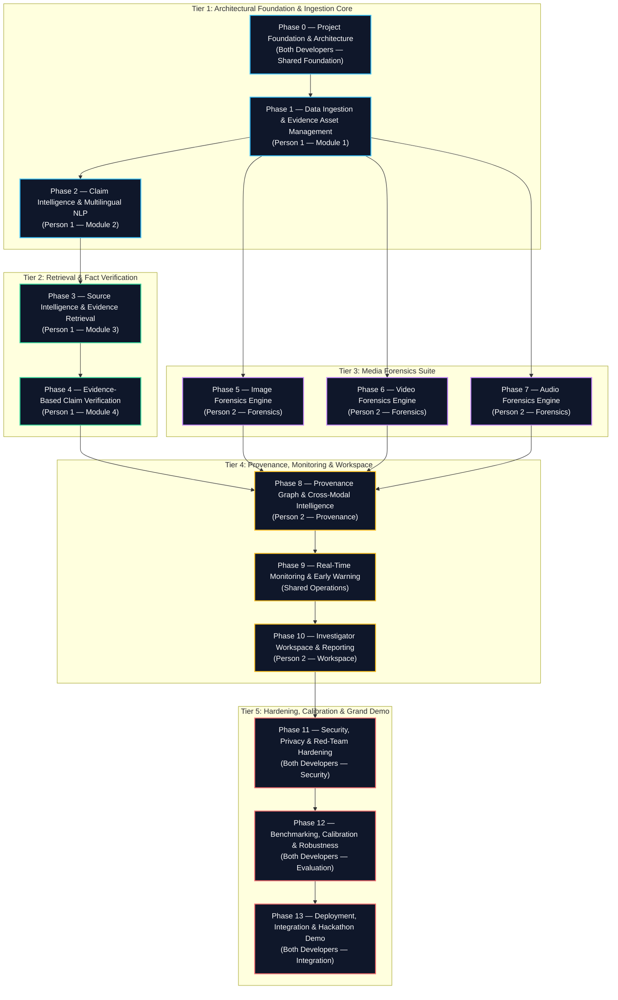

# PRAMAAN — Project Roadmap (Phase 0 – Phase 13)

**Project:** PRAMAAN (Provenance, Reliability & Authenticity Monitoring and Analysis Network)  
**Document:** Fixed System Roadmap & Ownership Matrix  
**Status:** Approved & Frozen Baseline  

---

## 1. Development Principles & Division of Ownership

PRAMAAN is built under a contract-first, modular architecture designed for independent multi-agent and multi-developer execution. The system features two independent engineering owners:

- **Person 1 (My Ownership):**
  - Data Ingestion & Evidence Asset Management
  - Claim Intelligence & Multilingual NLP
  - Source Intelligence & Evidence Retrieval
  - Evidence-Based Claim Verification
- **Person 2 (Teammate's Ownership):**
  - Image Forensics Engine
  - Video Forensics Engine
  - Audio Forensics Engine
  - Provenance Graph & Cross-Modal Intelligence
  - Investigator Workspace & Reporting

Both developers agree to the immutable Phase 0–13 roadmap below. No phase shall be renamed, merged, reordered, split, skipped, or renumbered.

---

## 2. Master Roadmap Specification

---

## 3. Phase Descriptions & Verification Exit Gates

### Phase 0 — Project Foundation & Architecture
- **Ownership:** Person 1 (Backend Foundation) & Person 2 (Shared Contracts Agreement)
- **Scope:** Repository structure, FastAPI backend foundation, shared Pydantic v2 data contracts, synthetic JSON fixtures, configuration, database session management, worker scaffold, Docker Compose configuration, documentation, automated contract and health tests.
- **Exit Gate:** Automated contract test suite passes with zero errors; health endpoints return HTTP 200; mock worker executes harmless task; all 12 schemas validated.

### Phase 1 — Data Ingestion & Evidence Asset Management
- **Ownership:** Person 1
- **Scope:** Ingests raw media files and URLs, calculates cryptographic hashes (SHA-256), extracts container metadata and EXIF, checks C2PA manifest presence, generates isolated storage URIs, creates `EvidenceAsset` records.
- **Exit Gate:** Multi-format file ingestion pipeline passes SSRF and path traversal security battery; SHA-256 verified; immutable asset records created.

### Phase 2 — Claim Intelligence & Multilingual NLP
- **Ownership:** Person 1
- **Scope:** Normalizes text, performs Automatic Speech Recognition (ASR) on extracted audio, executes OCR on visual text, identifies checkable atomic propositions, parses multilingual claims (English, Hindi, Indic languages), extracts entities, generates `Claim` records.
- **Exit Gate:** Unstructured text and audio inputs reliably produce atomic, checkable `Claim` entities with timecode/bounding box anchors and confidence scores.

### Phase 3 — Source Intelligence & Evidence Retrieval
- **Ownership:** Person 1
- **Scope:** Queries trusted search indexes, open-web archives, knowledge bases, and fact-checking repositories; computes source credibility weights; extracts relevant snippets; generates `SourceDocument` and `EvidenceItem` records.
- **Exit Gate:** Hybrid retrieval (BM25 + Dense vector KNN) returns relevant passages with page/snippet citations and domain credibility indicators.

### Phase 4 — Evidence-Based Claim Verification
- **Ownership:** Person 1
- **Scope:** Evaluates stance (SUPPORTS, REFUTES, NEUTRAL, INSUFFICIENT) between claims and evidence passages; synthesizes comprehensive rationales; outputs `ClaimAssessment` records.
- **Exit Gate:** Verification engine generates stance classifications citing explicit evidence IDs; handles contradictory and insufficient evidence gracefully without hallucination.

### Phase 5 — Image Forensics Engine
- **Ownership:** Person 2
- **Scope:** Error Level Analysis (ELA), frequency domain analysis (DCT/FFT), noise residual inconsistency, facial landmark warping detection, generative artifact identification; outputs `ForensicFinding` records.
- **Exit Gate:** Calibrated detector outputs distinguishable synthetic vs authentic visual anomalies with heatmaps.

### Phase 6 — Video Forensics Engine
- **Ownership:** Person 2
- **Scope:** Temporal consistency analysis, inter-frame flicker detection, lip-sync synchrony evaluation, facial reenactment boundary tracking; outputs `ForensicFinding` records.
- **Exit Gate:** Detects temporal discontinuities and audio-visual synchronization discrepancies across frame sequences.

### Phase 7 — Audio Forensics Engine
- **Ownership:** Person 2
- **Scope:** Spectral continuity analysis, synthetic vocoder residual detection, voice clone matching, background acoustic uniformity; outputs `ForensicFinding` records.
- **Exit Gate:** Identifies AI voice cloning artifacts and acoustic phase splices with calibrated confidence intervals.

### Phase 8 — Provenance Graph & Cross-Modal Intelligence
- **Ownership:** Person 2
- **Scope:** Constructs Directed Acyclic Graph (DAG) linking assets, derivations, claims, sources, and forensic findings; calculates cross-modal consistency; generates `ProvenanceRelationship` records.
- **Exit Gate:** Full provenance graph constructed and traversable, enabling click-through lineage from final claim back to source pixels or audio timecodes.

### Phase 9 — Real-Time Monitoring & Early Warning
- **Ownership:** Shared Operations
- **Scope:** Continuous stream monitoring, social media ingestion hooks, velocity tracking, automated alerting on viral emerging synthetic narratives.
- **Exit Gate:** Live stream simulated spike triggers automated threshold alerts and registers high-priority investigations.

### Phase 10 — Investigator Workspace & Reporting
- **Ownership:** Person 2
- **Scope:** Interactive web workspace for digital forensic investigators; multi-modal timeline visualizer; bounding box and heatmap inspector; exportable forensic dossier `InvestigationReport` in PDF/JSON-LD.
- **Exit Gate:** Investigator can inspect all evidence, adjust confidence thresholds, annotate findings, and export a legally admissible forensic report.

### Phase 11 — Security, Privacy & Red-Team Hardening
- **Ownership:** Person 1 & Person 2
- **Scope:** Adversarial robustness testing, prompt injection resistance, file bomb decompression safeguards, SSRF firewalling, PII redaction, encryption of stored evidence at rest and in transit.
- **Exit Gate:** Automated security test battery executes with zero high or critical vulnerabilities; sanitized logs contain no secrets or PII.

### Phase 12 — Benchmarking, Calibration & Robustness
- **Ownership:** Person 1 & Person 2
- **Scope:** Benchmarking against standardized synthetic and real datasets; temperature scaling and reliability diagram calibration; stress testing under variable compression and noise.
- **Exit Gate:** Published evaluation report with ROC-AUC, Brier score calibration curves, and latency metrics across diverse input qualities.

### Phase 13 — Deployment, Integration & Hackathon Demo
- **Ownership:** Person 1 & Person 2
- **Scope:** End-to-end containerized orchestration, reproducible demo seed datasets, automated health validation, showcase execution of 3 grand demonstration scenarios (News Disinformation, Voice Clone Extortion, Fabricated Video Leak).
- **Exit Gate:** Single-command bootstrap launches the integrated system; complete workflow executes smoothly in under 60 seconds with verified provenance.

