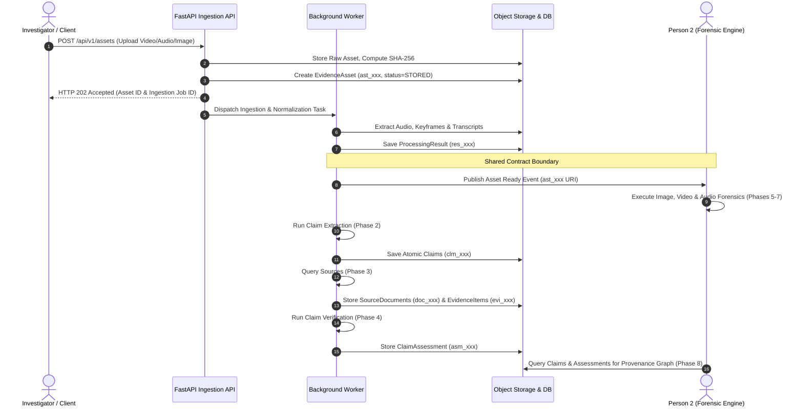

# Veritas — System Architecture Specification

> **Project:** Veritas — Provenance, Reliability & Authenticity Monitoring and Analysis Network  
> **Document:** System Architecture & Technical Design Specification  
> **Focus:** Person 1 Backend Architecture & Cross-System Integration  
> **Version:** 1.0.0  

---

## 1. Architectural Overview

Veritas operates as an asynchronous, event-driven, contract-first network. The system architecture segregates responsibilities cleanly between **Person 1** (Ingestion, Normalization, Claim Intelligence, and Retrieval Verification) and **Person 2** (Multimodal Media Forensics, Provenance Graph Synthesis, and Investigator Workspace).

```mermaid
flowchart TD
    subgraph ClientLayer["Presentation & API Consumers"]
        ExtAPI["External API Clients / Automated Monitors"]
        InvUI["Person 2 Investigator Workspace (Phase 10)"]
    end

    subgraph Person1Boundary["Person 1 Subsystem Boundary (This Repository)"]
        Gateway["FastAPI Gateway (/api/v1)"]
        AuthMiddleware["Security & Auth Middleware (JWT / Roles)"]
        
        subgraph CoreServices["Core Service Layer"]
            IngestSvc["Ingestion Service (Phase 1)"]
            NormSvc["Normalization Service (Phase 2)"]
            ClaimSvc["Claim Extraction Service (Phase 2)"]
            RetrievalSvc["Source Intelligence & RAG (Phase 3)"]
            VerifySvc["Claim Verification Engine (Phase 4)"]
        end

        subgraph WorkerEngine["Asynchronous Background Workers"]
            JobQueue["Job Queue (Redis / In-Memory Mock)"]
            WorkerNodes["Task Worker Nodes"]
        end

        subgraph Persistence["Storage & Persistence Adapters"]
            SQLDB[("PostgreSQL / SQLite Storage")]
            ObjectStore[("S3 / MinIO Object Storage")]
            VectorIndex[("Dense Vector & BM25 Index")]
        end

        Gateway --> AuthMiddleware
        AuthMiddleware --> CoreServices
        CoreServices --> JobQueue
        JobQueue --> WorkerNodes
        WorkerNodes --> Persistence
        CoreServices --> Persistence
    end

    subgraph Person2Boundary["Person 2 Subsystem Boundary (Peer System)"]
        ForensicEngines["Image, Video & Audio Forensics (Phases 5-7)"]
        ProvGraph["Provenance Graph Engine (Phase 8)"]
        ReportingService["Investigation Reporting Engine (Phase 10)"]
    end

    ExtAPI --> Gateway
    InvUI --> Gateway
    CoreServices -.->|Canonical Pydantic Contracts| ForensicEngines
    ForensicEngines -.->|ForensicFindings (fnd_)| ProvGraph
    CoreServices -.->|Claims (clm_) & Assessments (asm_)| ProvGraph
    ProvGraph -.-> ReportingService
    ReportingService -.-> InvUI
```

---

## 2. Person 1 Subsystem Breakdown

### 2.1 API & Routing Layer (`backend/app/api/`)
- Built on **FastAPI** exposing versioned REST endpoints prefixed with `/api/v1/`.
- Strict request and response serialization enforced through **Pydantic v2** models.
- Transparent RFC 9457 Problem Details error formats for 4xx and 5xx responses.
- Asynchronous handling (`async def`) for all I/O-bound endpoints (database queries, network retrieval).

### 2.2 Core Infrastructure & Configuration (`backend/app/core/`)
- **Centralized Settings (`config.py`):** Derived from `pydantic-settings.BaseSettings`, reading from environment variables or `.env`.
- **Structured Logging (`logging.py`):** JSON-formatted logs with correlation IDs, masking sensitive tokens, passwords, and PII.
- **Error Handlers (`errors.py`):** Global exception interceptors for `RequestValidationError`, `StarletteHTTPException`, and `VeritasException` (with backward-compatible `PramaanException` alias).

### 2.3 Database & Persistence Layer (`backend/app/db/`)
- Relational mapping using **SQLAlchemy 2.0** with explicit typing and declarative base models.
- **Session Factory (`session.py`):** Asynchronous session generator `get_db()` with automated rollback on unhandled exceptions.
- **Agnostic Test Adapter:** Supports local PostgreSQL in Docker, falling back seamlessly to in-memory SQLite (`sqlite:///:memory:`) for isolated testing.
- **Database Migrations:** Governed by **Alembic** for reproducible, version-controlled schema evolution.

### 2.4 Worker & Asynchronous Processing Engine (`workers/app/`)
- Decoupled worker architecture for long-running media hashing, transcription, embedding generation, and source retrieval.
- Task status state machine: `QUEUED` -> `PROCESSING` -> (`COMPLETED` | `FAILED`).
- Abstract Task Runner interface allowing execution via Redis in production or in-process asyncio queues during local testing.

---

## 3. Data Flow: From Content Ingestion to Claim Verification



---

## 4. Integration Protocol with Person 2

Person 1 and Person 2 develop completely independently on different physical machines. To ensure guaranteed compatibility:

1. **Shared Contract Directory (`contracts/`):** Both repositories synchronize from a canonical contract specification containing Pydantic v2 models and JSON schema exports.
2. **Stable Prefixed Identifiers:** All cross-referenced entities use 3-character prefixes followed by standard UUIDv4 (`inv_`, `ast_`, `clm_`, `fnd_`, `rel_`, `rpt_`).
3. **Decoupled Verification vs. Forensics:**
   - Person 1 evaluates **semantic factuality** (`ClaimAssessment` -> `SUPPORTED`, `REFUTED`, etc.).
   - Person 2 evaluates **media signal manipulation** (`ForensicFinding` -> `LIKELY_SYNTHETIC`, `LIKELY_AUTHENTIC`, `INCONCLUSIVE`).
   - Neither developer modifies or overrides the other's domain findings.
4. **Epistemic Rigor in Forensic Scoring:**
   - Forensic detectors produce raw scores (logits, distance metrics, anomaly indices). Bounding a score to $[0, 1]$ does not make it a probability.
   - `ForensicFinding` separates `raw_score` from `calibrated_score`. Calibration requires explicit empirical verification (`calibration_status: "CALIBRATED"` with documented method and holdout validation metadata).
5. **Asset Derivation vs. Provenance Graph DAG Boundaries:**
   - `AssetDerivation` validates local immediate invariants (`derived_asset_id != parent_asset_id`) to block direct 1-hop self-references.
   - Complete multi-hop cycle detection (`A -> B -> C -> A`) is an explicit architectural responsibility of Person 2's **Provenance Graph Engine (Phase 8)** via graph traversal algorithms, not the single-record contract layer.
6. **Mock Fixture Interchange:** Person 1 tests claim workflows using synthetic `ForensicFinding` fixtures; Person 2 tests graph algorithms using synthetic `Claim` and `ClaimAssessment` fixtures.


