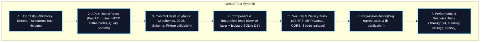

# Veritas — Test Strategy & Verification Protocol

> **Project Identity:** Veritas (architecturally designated as PRAMAAN — Provenance, Reliability & Authenticity Monitoring and Analysis Network)  
> **Document:** Test Strategy, Verification Gates & Quality Assurance Standards  
> **Target:** 100% Deterministic, Decoupled, Multi-Dimensional Testing  

---

## 1. Quality Assurance Philosophy

Veritas enforces an uncompromising testing discipline:
- **No Mocking of Real Truth in Evaluation:** Mocks are strictly reserved for isolated unit tests and external test doubles. In later AI evaluation phases, real detectors must be evaluated on real labeled datasets.
- **Zero Inter-Developer Coupling:** Every test suite must execute cleanly on a single developer workstation without requiring the peer developer's backend, database, or network services.
- **Fail Early, Fail Safely:** Malformed inputs or dependency failures must yield clean RFC 9457 error messages and must never silently corrupt database state or emit false positive verdicts.

---

## 2. The 7-Tier Testing Pyramid



---

## 3. Test Tier Specifications

### 3.1 Unit Tests (`tests/unit/`)
- **Scope:** Pure functions, Pydantic field validators, UUID prefix generators, timestamp formatters, and exception mappers.
- **Execution Speed:** Target < 1.0 second for the entire suite.
- **Environment:** Zero network, in-memory, mock system clock.

### 3.2 API Tests (`backend/tests/`)
- **Scope:** FastAPI endpoints (`GET /health`, `GET /api/v1/health`, OpenAPI docs).
- **Tooling:** `httpx.AsyncClient` or FastAPI `TestClient`.
- **Validation:** HTTP status codes, response content-type, problem details error format on bad requests, CORS headers.

### 3.3 Contract Tests (`tests/contract/`)
- **Scope:** Verifies that all 12 shared schemas accurately parse valid JSON fixtures and cleanly reject invalid payloads with descriptive errors.
- **Inter-Developer Sync:** Person 2 imports these schemas or consumes the exported JSON Schema definitions to validate their mock payloads.

### 3.4 Component & Integration Tests (`tests/integration/`)
- **Scope:** End-to-end service layer orchestration connecting FastAPI routes to the SQLAlchemy database layer.
- **Database Isolation:** Runs against `sqlite:///:memory:` with fresh schema creation and teardown per test session. Never touches a persistent production or development database.

### 3.5 Security & Privacy Tests (`tests/security/`)
- **Scope:** Validates path traversal blocks (`../../`), SSRF protections on URL ingestion, file size limits, CORS restrictions, and token masking in logging outputs.

### 3.6 Regression Tests
- **Policy:** Every fixed defect (e.g. DEF-001 through DEF-006) receives an automated regression test that remains permanently in the test suite. No failing test may be deleted or weakened.

### 3.7 Performance & Evaluation Tests (Phases 11–12)
- **Scope:** Evaluates latency per media minute during transcription and claim extraction. Measures memory consumption and GPU VRAM headroom.
- **AI Evaluation Metrics:** Precision, Recall, F1, and Brier Score for claim verification and forensic anomaly detectors.

---

## 4. Execution Commands & Guidelines

All tests are executed via `pytest`:

```bash
# Run all unit tests
pytest tests/unit -v

# Run all contract tests
pytest tests/contract -v

# Run backend API tests
pytest backend/tests -v

# Run full Phase 0 test battery
pytest tests backend/tests workers/tests -v
```

