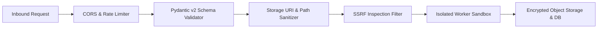

# Veritas — Threat Model & Security Architecture

> **Project Identity:** Veritas (architecturally designated as PRAMAAN — Provenance, Reliability & Authenticity Monitoring and Analysis Network)  
> **Document:** Threat Model, Attack Surface Analysis & Mitigation Strategy  
> **Standard:** STRIDE Framework & OWASP Top 10 API Security Risks  

---

## 1. Threat Modeling Overview

As a deepfake analysis and provenance verification network, Veritas is an attractive target for adversaries seeking to:
1. Bypass detection to disseminate synthetic disinformation without detection.
2. Sabotage forensic pipelines via poisoned inputs or malicious payloads.
3. Exfiltrate sensitive whistleblower evidence or investigator notes.
4. Forge provenance credentials to grant synthetic media the appearance of authenticity.

---

## 2. Attack Vectors & Safeguards Matrix

| Threat Category (STRIDE) | Attack Vector | Potential Impact | Phase 0 Implemented Safeguard | Planned Future Safeguards (Phases 1–12) |
| :--- | :--- | :--- | :--- | :--- |
| **Tampering / Spoofing** | **Malicious File Uploads & Polyglot Files** | Remote code execution or buffer overflow during media parsing. | Strict MIME validation via Pydantic; SHA-256 hash validation; filename sanitization. | Sandboxed isolated decoding containers; FFmpeg memory limits; static binary execution in zero-network Docker. |
| **Denial of Service** | **Oversized Requests & Decompression Bombs** | Exhaustion of server RAM, CPU, or disk storage. | Configurable `MAX_UPLOAD_SIZE_BYTES = 500MB` in Pydantic Settings; early header inspection. | Streaming chunk-level size caps; worker queue rate-limiting; memory-capped worker processes. |
| **Information Disclosure** | **Path Traversal Attacks** (`../../etc/passwd`) | Arbitrary filesystem read or overwrite. | File paths are completely forbidden in public APIs; abstract storage URIs (`file:///var/...` or `s3://...`) generated with UUIDs. | Chrooted storage directories; read-only container root filesystems; secure UUID-based object keys. |
| **Elevation of Privilege** | **Server-Side Request Forgery (SSRF)** | Ingestion worker fetches AWS metadata (`169.254.169.254`) or internal subnets (`10.0.0.0/8`, `127.0.0.1`). | Architecture specification requires strict IP blocklists on ingestion URL parsers. | DNS resolution validation; blocking private IP ranges (RFC 1918 / RFC 3927); dedicated egress firewall. |
| **Tampering** | **Prompt Injection into Claim Extraction** | Adversarial instructions hidden in OCR text or speech to override LLM verification logic. | Strict separation between extracted claim strings and verification prompt templates. | Structured XML output parsing; zero-shot validation filters; adversarial red-team test batteries (Phase 11). |
| **Elevation of Privilege** | **Unauthorized Access to Evidence** | Unauthenticated user views private investigation or leaks draft forensic reports. | Bearer token authorization structure; role-based access control (RBAC) schema definition. | Cryptographic JWT verification; granular investigation ACLs; tenant isolation. |
| **Information Disclosure** | **Secret & Credential Leakage** | Database passwords or MinIO keys accidentally committed or logged. | Zero committed secrets in Git; strict `.gitignore`; `.env.example` using dummy values; structured logging with token redacting. | Pre-commit git secret scanners; HashiCorp Vault / AWS Secrets Manager integration. |
| **Information Disclosure** | **Unsafe CORS Defaults** | Arbitrary malicious web domains query investigative API endpoints. | Explicit `CORS_ORIGINS` configuration in Pydantic settings; wildcards (`*`) forbidden in production. | Strict Origin header verification; SameSite cookie policies for UI sessions. |
| **Tampering** | **Dependency Vulnerabilities & Poisoning** | Supply-chain compromises in third-party Python packages. | Pinned dependency specifications in `pyproject.toml`; minimal dependency footprint in Phase 0. | Automated Dependabot scanning; automated vulnerability audits (`pip-audit`, Bandit); container minimal images. |

---

## 3. Defense-in-Depth Implementation Roadmap

1. **Phase 0 Baseline (Active):** Strict schema bounds, mandatory UTC dates, strongly-typed UUID prefixes, RFC 9457 structured errors, isolated in-memory testing.
2. **Phase 1 Ingestion Boundary:** Static media headers verified via magic bytes; path traversal attempts rejected before touching disk.
3. **Phase 11 Hardening Boundary:** Adversarial red-team test suites, container breakouts, automated fuzzing.

