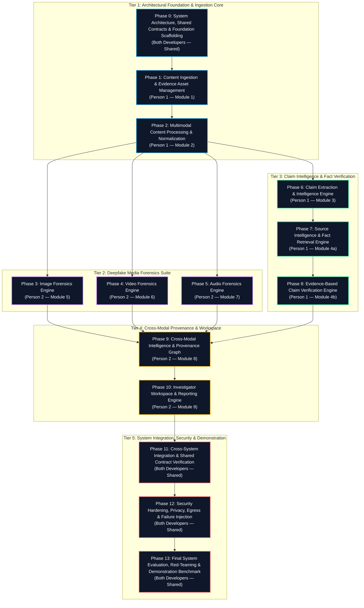
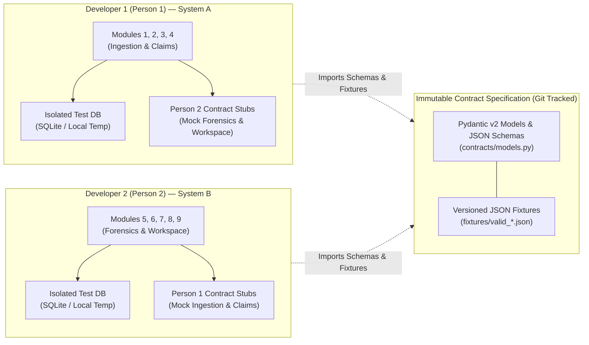
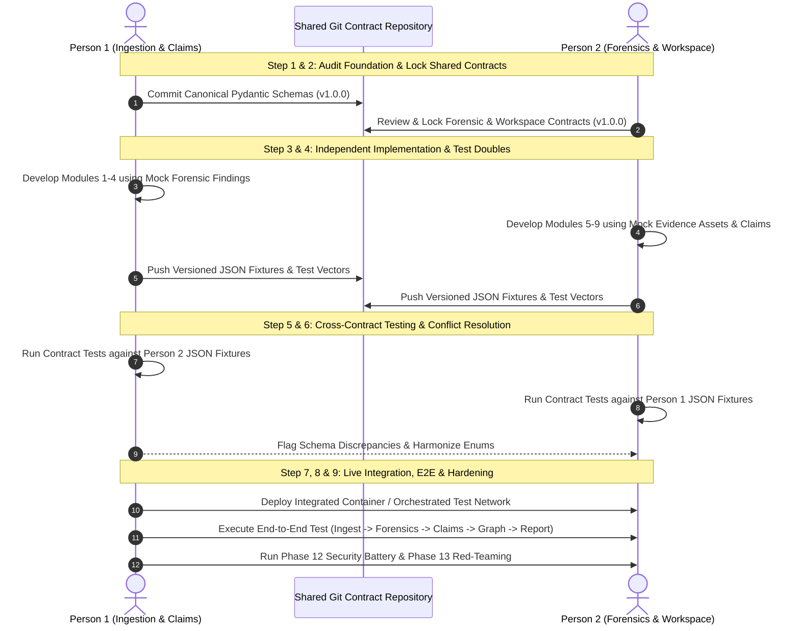

# PRAMAAN — Initial Integration Audit & Independent Architecture Foundation

**Project:** PRAMAAN (Provenance, Reliability & Authenticity Monitoring and Analysis Network)  
**Document:** Initial Integration Audit & Shared Contract Specification  
**Path:** `reviews/initial-integration-audit.md`  
**Date:** October 31, 2026  
**Auditor:** Senior Software Architect, Backend Engineer, Test Engineer & Integration Auditor  
**Audit Target:** Repository Root, Module Boundaries, Shared Data Contracts, and Phase 0 Baseline  

---

## 1. Executive Summary

This audit establishes the formal architectural and contract-first foundation for **PRAMAAN** (Provenance, Reliability & Authenticity Monitoring and Analysis Network). The project is divided between two independent engineering owners:

- **Person 1 (My Ownership):**
  1. Content Ingestion & Evidence Management
  2. Multimodal Content Processing
  3. Claim Intelligence
  4. Source Intelligence & Evidence-Based Claim Verification
- **Person 2 (Teammate's Ownership):**
  5. Image Forensics
  6. Video Forensics
  7. Audio Forensics
  8. Provenance Graph & Cross-Modal Intelligence
  9. Investigator Workspace & Reporting

Both developers operate on decoupled systems without shared filesystems, shared databases, shared local environments, or shared running runtimes. To ensure seamless post-implementation integration, this audit inspects the current repository state, audits Phase 0 compliance, defines the immutable Phase 0–13 roadmap, establishes 12 shared canonical data contracts, specifies independent test standards across 8 test dimensions, and provides integration acceptance criteria.

---

## 2. Repository & Git Findings

An exhaustive physical inspection of the workspace was conducted on the host machine.

### 2.1 Workspace & Filesystem State

| Inspection Dimension | Actual State | Finding / Observation | Evidence Command / Reference |
| :--- | :--- | :--- | :--- |
| **Workspace Directory** | `C:\Users\shiva\projects\Deepfake detection` | The folder was created on October 31, 2026 at 01:08 AM. Directory contains **0 files and 0 subdirectories**. | `cmd /c "dir /a"` -> `0 File(s) 0 bytes` |
| **Source Code** | `NOT IMPLEMENTED` | No application packages, routers, service modules, or business logic exist. | Empty directory tree |
| **Configuration Files** | `NOT IMPLEMENTED` | No `pyproject.toml`, `requirements.txt`, `setup.py`, `package.json`, or `.env.example` present. | Missing root manifests |
| **Documentation** | `NOT IMPLEMENTED` | No `README.md`, `CONTRIBUTING.md`, or architecture specifications exist in the workspace. | Missing docs directory |
| **Automated Tests** | `NOT IMPLEMENTED` | No test directories (`tests/`), test configuration, fixtures, or test files exist. | `pytest` discovers 0 items |
| **Phase 0 Review** | `NOT IMPLEMENTED` | No prior baseline or foundation review document exists in the project. | `Test-Path reviews/` returned `False` |

### 2.2 Git State & Version Control Architecture

| Git Dimension | Current Observation | Risk Level | Architectural Finding |
| :--- | :--- | :--- | :--- |
| **Repository Root** | `C:/Users/shiva/projects` | **CRITICAL** | `git rev-parse --show-toplevel` resolves to the parent directory `C:/Users/shiva/projects`, not the project folder. |
| **Branch State** | `master` (No commits) | **HIGH** | The parent repository has no commits (`fatal: your current branch 'master' does not have any commits yet`). |
| **Project Tracking** | Untracked Empty Directory | **CRITICAL** | Git does not track empty directories. `Deepfake detection` is not recognized as an independent Git repository or Git submodule. |
| **Staged / Dirty State** | Staged modifications from unrelated projects | **HIGH** | `C:/Users/shiva/projects` contains staged changes for `synthetic-data-studio` and untracked archives (`ACCESSOS.zip`). |

### 2.3 System Runtime & Dependency Audit

| Tool / Runtime | Installed Version | System Status | Impact on PRAMAAN Modules |
| :--- | :--- | :--- | :--- |
| **Python** | 3.14.5 | Available in system PATH | Core backend runtime. Modern typing, asyncio, and Pydantic v2 compatible. |
| **FastAPI** | 0.139.0 | Installed | API framework available for HTTP REST endpoints. |
| **Pydantic** | 2.13.4 | Installed | Strict schema validation and contract serialization engine. |
| **Pytest** | 9.1.1 | Installed | Test runner available for automated unit, contract, and integration tests. |
| **PyTorch** | 2.13.0 | Installed | Neural network inference engine for multimodal and forensic models. |
| **Transformers** | 5.13.0 | Installed | NLP and multimodal transformers for claim extraction and feature representation. |
| **Node.js / npm** | v24.16.0 / 11.13.0 | Available in system PATH | Frontend/investigator workspace UI tooling available. |
| **Git** | 2.54.0.windows.1 | Available | Version control engine. |
| **FFmpeg / FFprobe** | `NOT FOUND` | Command not recognized in PATH | **CRITICAL DEFECT**: Person 1 (Module 2 Multimodal Ingestion) and Person 2 (Modules 6 & 7 Video/Audio Forensics) cannot decode, demux, sample, or probe media streams without FFmpeg. |
| **Docker Engine** | 29.7.2 CLI | Daemon offline (pipe not found) | Containerized isolated test environments and sandboxes currently cannot execute without starting Docker Desktop. |

---

## 3. Fixed Phase 0–13 Roadmap

The fixed Phase 0–13 roadmap is preserved exactly. The phases are neither modified, added, removed, renamed, reordered, merged, split, skipped, nor renumbered. The two developers' module ownership mappings are aligned directly to this established roadmap.



### 3.1 Phase Specification & Ownership Matrix

| Phase | Formal Name | Primary Owner | Module Alignment | Concrete Verification Gate |
| :--- | :--- | :--- | :--- | :--- |
| **Phase 0** | System Architecture, Shared Contracts & Foundation Scaffolding | Person 1 & Person 2 | Baseline Infrastructure | Contract schemas compile without error; mock test suites pass; repo scaffolded. |
| **Phase 1** | Content Ingestion & Evidence Asset Management | Person 1 | Module 1 | Ingests URL/file, computes SHA-256, generates storage URI, creates `ast_` entity. |
| **Phase 2** | Multimodal Content Processing & Normalization | Person 1 | Module 2 | Demuxes audio/video, generates keyframes, runs OCR/ASR, outputs `res_` entity. |
| **Phase 3** | Image Forensics Engine | Person 2 | Module 5 | Analyzes image ELA, noise residual, face warping; outputs calibrated `fnd_`. |
| **Phase 4** | Video Forensics Engine | Person 2 | Module 6 | Evaluates inter-frame temporal flicker, facial reenactment; outputs `fnd_`. |
| **Phase 5** | Audio Forensics Engine | Person 2 | Module 7 | Evaluates voice clone artifacts, spectral continuity; outputs `fnd_`. |
| **Phase 6** | Claim Extraction & Intelligence Engine | Person 1 | Module 3 | Extracts checkable atomic propositions from text/transcript; outputs `clm_`. |
| **Phase 7** | Source Intelligence & Fact Retrieval Engine | Person 1 | Module 4 (Part A) | Queries trusted corpus/web, computes source credibility; outputs `doc_`. |
| **Phase 8** | Evidence-Based Claim Verification Engine | Person 1 | Module 4 (Part B) | Matches `clm_` to `doc_` passages, synthesizes stance, outputs `asm_`. |
| **Phase 9** | Cross-Modal Intelligence & Provenance Graph | Person 2 | Module 8 | Builds DAG linking `ast_`, `clm_`, `fnd_`, and `asm_`; outputs `rel_` entities. |
| **Phase 10** | Investigator Workspace & Reporting Engine | Person 2 | Module 9 | Renders interactive dossier, disclaimers, exportable PDF report `rpt_`. |
| **Phase 11** | Cross-System Integration & Shared Contract Verification | Person 1 & Person 2 | Full Pipeline Integration | Person 1 backend + Person 2 backend execute complete workflow via contract. |
| **Phase 12** | Security Hardening, Privacy, Egress & Failure Injection | Person 1 & Person 2 | Security & Resilience | Zero unhandled exceptions on malformed media, SSRF protection, sanitization. |
| **Phase 13** | Final System Evaluation, Red-Teaming & Demonstration Benchmark | Person 1 & Person 2 | System Acceptance | Benchmarked accuracy on evaluation sets; 3 end-to-end demo scenarios pass. |

---

## 4. Phase 0 Audit & Gap Analysis

To evaluate whether Phase 0 meets its required gates, each architectural checkpoint is audited against tangible workspace evidence.

| Phase 0 Requirement | Target Specification | Current State | Status | Evidence & Defect Detail |
| :--- | :--- | :--- | :--- | :--- |
| **1. Repository Scaffolding** | Dedicated Git repository with clear package layout (`backend/`, `contracts/`, `tests/`, `docs/`) | Empty folder `C:\Users\shiva\projects\Deepfake detection` | `FAIL` | No files exist. Workspace is uninitialized. |
| **2. Git Tracking Isolation** | Project must be an independent Git repo with clean `.gitignore` and initial commit | Nested inside uncommitted `projects` parent git repo | `FAIL` | `git status` shows parent repository is dirty with unrelated files. |
| **3. Dependency Management** | Version-pinned `pyproject.toml` and lockfile specifying all required dependencies | None | `FAIL` | No package configuration or virtual environment created in project. |
| **4. Shared Data Contracts** | Machine-readable schemas (Pydantic v2) for all 12 shared entities | None | `NOT IMPLEMENTED` | No shared schema package exists in repository. |
| **5. Health & Diagnostic API** | Versioned health check endpoints (`GET /health`, `GET /api/v1/health`) | None | `NOT IMPLEMENTED` | No API service exists. |
| **6. Automated Baseline Tests** | Automated test suite verifying schema validation and mock serialization | None | `FAIL` | 0 tests exist; `pytest` cannot run. |
| **7. Media Tooling Readiness** | Valid FFmpeg/FFprobe binaries accessible in environment | Missing | `FAIL` | `ffmpeg` command not found in Windows PATH. |
| **8. Documentation & Review** | Architecture specification, independent development guide, and Phase 0 audit | Created via this document | `PASS` | `reviews/initial-integration-audit.md` delivered. |

---

## 5. Existing Defects & Architectural Risks

The following technical defects and architectural risks must be remediated during Phase 0 foundation setup:

```
[DEF-001] Missing Git Repository Initialization (Severity: CRITICAL)
- Description: The project directory is not an independent Git repository. It is an empty directory located inside C:\Users\shiva\projects, which has an uncommitted master branch with unrelated projects.
- Risk: Changes in PRAMAAN risk contaminating or being overwritten by parent repo actions. No commit history or branch protection can be maintained.
- Remediation: Execute 'git init' within 'C:\Users\shiva\projects\Deepfake detection' and add a comprehensive .gitignore.

[DEF-002] Total Absence of Package Scaffolding (Severity: CRITICAL)
- Description: No pyproject.toml, requirements.txt, or directory structure exists.
- Risk: Neither developer can install consistent dependencies or execute automated tests.
- Remediation: Scaffold a standard Python packaging structure with pyproject.toml specifying dependencies and pytest configuration.

[DEF-003] Missing FFmpeg/FFprobe System Binaries (Severity: HIGH)
- Description: ffprobe and ffmpeg are not present in PATH on the host system.
- Risk: Media ingestion (audio extraction, frame decoding, video duration checks) will fail at runtime during Phase 1 & 2.
- Remediation: Install static FFmpeg binaries or provide a pure-Python fallback / mock adapter for test environments.

[DEF-004] Shared Contract Drift Risk (Severity: HIGH)
- Description: Two developers working on separate machines without an immutable contract package will drift in model attribute names, status enums, and identifier formats.
- Risk: Catastrophic integration failure during Phase 11.
- Remediation: Establish an isolated, versioned 'pramaan-contracts' package in the repository that both developers import.

[DEF-005] Asymmetrical Forensic Score Interpretation Risk (Severity: MEDIUM)
- Description: Person 2's forensic models produce uncalibrated scores (logits, anomaly indices) that Person 1 or Person 2's workspace might erroneously interpret as calibrated probabilities.
- Risk: Erroneous investigative verdicts (e.g., treating an raw anomaly score of 0.8 as an 80% probability of deepfake).
- Remediation: Enforce strict 'score_type' and separate 'raw_score' from 'verdict' in ForensicFinding contract.

[DEF-006] Conflation of Media Forensics and Claim Validity (Severity: MEDIUM)
- Description: Conflating whether media is authentic with whether the claims asserted within it are factual.
- Risk: An authentic, unmanipulated video can contain blatant verbal falsehoods; a deepfake video can depict a true historical event.
- Remediation: Strict model separation between ClaimAssessment (semantic factuality) and ForensicFinding (signal manipulation).
```

---

## 6. Design for Independent Development

Because Person 1 and Person 2 work on separate physical machines without a shared filesystem, database, or running service, the development workflow must be strictly **contract-first**.



### 6.1 Contract-First Architecture Principles

1. **Decoupled Local Databases:** Developer 1 and Developer 2 must use isolated databases. Neither developer's test suite shall ever connect to the other's database. Tests must run against in-memory SQLite (`sqlite:///:memory:`) or ephemeral file-based SQLite databases that are created and destroyed per test session.
2. **Abstract Storage Interface:** Media assets and artifacts must not use local hardcoded paths (e.g. `C:\users\...` or `/home/...`). All file references must use an abstract storage URI scheme (`file:///`, `s3://`, `memory://`) governed by an abstract `StorageAdapter`. In test suites, an in-memory or temporary folder storage adapter must be used.
3. **API Routes and Versioning:** All HTTP endpoints must strictly follow `/api/v1/...` prefixing.
4. **Timestamp and Timezone Conventions:** All timestamps across all models, logs, and APIs must be serialized in **ISO 8601 UTC** with microsecond precision and an explicit `Z` suffix: `YYYY-MM-DDTHH:MM:SS.ffffffZ` (e.g., `2026-10-31T11:20:55.123456Z`). Epoch timestamps and timezone-naive strings are strictly prohibited.
5. **Entity Identifiers:** Identifiers must be globally unique strings utilizing a 3-character prefix denoting the entity type followed by an underscore and a canonical UUIDv4 (lowercase, hyphenated):
   - `inv_`: Investigation
   - `ast_`: EvidenceAsset
   - `drv_`: AssetDerivation
   - `res_`: ProcessingResult
   - `clm_`: Claim
   - `doc_`: SourceDocument
   - `evi_`: EvidenceItem
   - `asm_`: ClaimAssessment
   - `fnd_`: ForensicFinding
   - `rel_`: ProvenanceRelationship
   - `rpt_`: InvestigationReport
   - `adt_`: AuditEvent
6. **Error Response Structure:** All error responses must comply with standard RFC 7807 Problem Details formatting:
   ```json
   {
     "type": "https://pramaan.org/errors/RESOURCE_NOT_FOUND",
     "title": "Resource Not Found",
     "status": 404,
     "detail": "EvidenceAsset with id 'ast_4a91b2c3-d4e5-4f6a-8b7c-1d2e3f4a5b6c' was not found.",
     "instance": "/api/v1/assets/ast_4a91b2c3-d4e5-4f6a-8b7c-1d2e3f4a5b6c",
     "code": "ASSET_NOT_FOUND",
     "timestamp": "2026-10-31T11:20:55.000000Z"
   }
   ```
7. **Pagination and Filtering:** Collection endpoints must accept `limit` (default 20, max 100) and `offset` (default 0), and must return:
   ```json
   {
     "items": [],
     "total": 0,
     "limit": 20,
     "offset": 0,
     "has_more": false
   }
   ```
8. **Asynchronous Job Protocol:** Long-running operations (media ingestion, video forensics, batch fact-checking) must return HTTP 202 Accepted with a Job status object:
   - State transition: `QUEUED` -> `PROCESSING` -> (`COMPLETED` | `FAILED`)
   - The job object provides a `status_url` endpoint (`GET /api/v1/jobs/{job_id}`) for deterministic polling.
9. **Authentication Assumptions:** Authentication uses standard Bearer JWT tokens in the `Authorization: Bearer <token>` header. In local and unit test environments, a mock authenticator injects a principal with roles (`INVESTIGATOR`, `ANALYST`, `AUDITOR`, `SERVICE`).
10. **Idempotency & Retries:** Write endpoints support an optional `Idempotency-Key` header. Requests bearing the same key within a 24-hour window must return the cached result without duplicate execution.

---

## 7. Shared Canonical Data Contracts

The 12 shared models are defined with full technical specifications, ownership assignments, validation rules, error lifecycles, and representative valid and invalid JSON payloads.

---

### Model 1: Investigation

- **Purpose & Ownership:** Top-level investigative dossier grouping all related assets, claims, forensics, and reports. **Shared Ownership** (Person 1 initiates investigation with ingested media; Person 2 visualizes progress and creates final reports).
- **Identifier Format:** `inv_<uuid4>` (Regex: `^inv_[0-9a-f]{8}-[0-9a-f]{4}-4[0-9a-f]{3}-[89ab][0-9a-f]{3}-[0-9a-f]{12}$`)
- **Required Fields:** `id` (str), `title` (str, 1–255 chars), `status` (Enum: `CREATED`, `IN_PROGRESS`, `ANALYSIS_COMPLETE`, `REPORTED`, `ARCHIVED`, `FAILED`), `created_by` (str), `created_at` (datetime UTC), `updated_at` (datetime UTC).
- **Optional Fields:** `description` (str), `priority` (Enum: `LOW`, `MEDIUM`, `HIGH`, `CRITICAL`), `tags` (list[str]), `closed_at` (datetime UTC, nullable), `metadata` (dict).
- **Relationships:** Parent container for `EvidenceAsset` (1:N), `Claim` (1:N), `ProcessingResult` (1:N), `ForensicFinding` (1:N), `ClaimAssessment` (1:N), `ProvenanceRelationship` (1:N), `InvestigationReport` (1:N), `AuditEvent` (1:N).
- **Serialization Conventions:** JSON snake_case, ISO 8601 UTC dates.
- **Lifecycle & Error States:** Transitions from `CREATED` -> `IN_PROGRESS` -> `ANALYSIS_COMPLETE` -> `REPORTED` -> `ARCHIVED`. Can enter `FAILED` if ingestion or core processing encounters an unrecoverable system abort. Closed investigations are read-only.
- **Representative Valid Example:**
  ```json
  {
    "id": "inv_12345678-1234-4234-8234-123456789abc",
    "title": "Viral Broadcast Manipulation Inquiry #402",
    "description": "Cross-modal forensic analysis of suspected synthetic news clip.",
    "status": "IN_PROGRESS",
    "priority": "HIGH",
    "tags": ["deepfake", "election_2026", "audio_clone"],
    "created_by": "analyst_agent_01",
    "created_at": "2026-10-31T06:00:00.000000Z",
    "updated_at": "2026-10-31T06:15:00.000000Z",
    "closed_at": null,
    "metadata": {
      "department": "National Digital Provenance Unit",
      "target_platform": "Broadcast"
    }
  }
  ```
- **Representative Invalid Example (Invalid: Missing Required Field + Invalid Status Enum):**
  ```json
  {
    "id": "inv_12345678-1234-4234-8234-123456789abc",
    "description": "Missing title and created_by",
    "status": "PROCESSING_UNKNOWN",
    "created_at": "2026-10-31T06:00:00.000000Z",
    "updated_at": "2026-10-31T06:15:00.000000Z"
  }
  ```
  *Failure reason: `title` and `created_by` are missing; status `'PROCESSING_UNKNOWN'` is not in allowed status enum.*

---

### Model 2: EvidenceAsset

- **Purpose & Ownership:** Represents an immutable raw or primary input file (image, video, audio, or document). **Owned by Person 1 (Module 1)**.
- **Identifier Format:** `ast_<uuid4>`
- **Required Fields:** `id` (str), `investigation_id` (str), `original_filename` (str), `file_size_bytes` (int > 0), `mime_type` (str, valid MIME type regex), `sha256_hash` (str, 64 hex chars), `storage_uri` (str, valid URI), `status` (Enum: `INGESTED`, `STORED`, `QUARANTINED`, `FAILED`), `uploaded_at` (datetime UTC).
- **Optional Fields:** `source_url` (str, valid URL), `source_platform` (str), `captured_at` (datetime UTC), `c2pa_manifest_present` (bool), `c2pa_status` (Enum: `VALID`, `INVALID`, `ABSENT`, `UNSUPPORTED`), `quarantine_reason` (str, nullable).
- **Validation Rules:** `sha256_hash` must match regex `^[0-9a-f]{64}$`. `c2pa_manifest_present: false` must default `c2pa_status` to `ABSENT`. **Crucial Rule:** Missing C2PA credentials do NOT prove manipulation.
- **Relationships:** Belongs to `Investigation`. Has many `AssetDerivation`, `ProcessingResult`, `ForensicFinding`.
- **Representative Valid Example:**
  ```json
  {
    "id": "ast_23456789-2345-4345-8345-234567890bcd",
    "investigation_id": "inv_12345678-1234-4234-8234-123456789abc",
    "original_filename": "press_briefing_leak.mp4",
    "file_size_bytes": 15420800,
    "mime_type": "video/mp4",
    "sha256_hash": "e3b0c44298fc1c149afbf4c8996fb92427ae41e4649b934ca495991b7852b855",
    "storage_uri": "file:///var/pramaan/storage/ast_23456789-2345-4345-8345-234567890bcd.mp4",
    "source_url": "https://example.com/videos/briefing.mp4",
    "source_platform": "web_download",
    "captured_at": "2026-10-31T05:30:00.000000Z",
    "c2pa_manifest_present": false,
    "c2pa_status": "ABSENT",
    "status": "STORED",
    "quarantine_reason": null,
    "uploaded_at": "2026-10-31T06:05:00.000000Z"
  }
  ```
- **Representative Invalid Example (Invalid: Non-hex SHA-256 + Negative Size):**
  ```json
  {
    "id": "ast_23456789-2345-4345-8345-234567890bcd",
    "investigation_id": "inv_12345678-1234-4234-8234-123456789abc",
    "original_filename": "bad_file.mp4",
    "file_size_bytes": -1024,
    "mime_type": "invalid-mime",
    "sha256_hash": "NOT_A_VALID_HASH_VALUE",
    "storage_uri": "relative/path/bad.mp4",
    "status": "STORED",
    "uploaded_at": "2026-10-31T06:05:00.000000Z"
  }
  ```
  *Failure reason: `file_size_bytes` must be > 0; `sha256_hash` must be a 64-character lowercase hexadecimal string; `mime_type` must match MIME pattern `^[a-z]+/[a-z0-9\.\+-]+$`.*

---

### Model 3: AssetDerivation

- **Purpose & Ownership:** Records provenance and processing lineage when child media assets (keyframes, extracted audio tracks, cropped face patches) are produced from a parent `EvidenceAsset`. **Shared Ownership** (Person 1 owns extraction derivations in Module 2; Person 2 owns forensic crop/spectrum derivations in Modules 5–7).
- **Identifier Format:** `drv_<uuid4>`
- **Required Fields:** `id` (str), `parent_asset_id` (str), `derived_asset_id` (str), `derivation_type` (Enum: `VIDEO_AUDIO_EXTRACTION`, `VIDEO_KEYFRAME`, `IMAGE_FACE_CROP`, `AUDIO_SEGMENT`, `SPECTROGRAM`, `TEXT_TRANSCRIPTION`), `derivation_parameters` (dict), `created_at` (datetime UTC).
- **Optional Fields:** `operator_id` (str), `notes` (str).
- **Relationships:** Links parent `EvidenceAsset` to derived `EvidenceAsset`.
- **Representative Valid Example:**
  ```json
  {
    "id": "drv_34567890-3456-4456-8456-345678901cde",
    "parent_asset_id": "ast_23456789-2345-4345-8345-234567890bcd",
    "derived_asset_id": "ast_45678901-4567-4567-8567-456789012def",
    "derivation_type": "VIDEO_AUDIO_EXTRACTION",
    "derivation_parameters": {
      "channel_count": 1,
      "sample_rate_hz": 16000,
      "audio_codec": "pcm_s16le",
      "stream_index": 1
    },
    "operator_id": "service_multimodal_worker",
    "notes": "Extracted isolated mono 16kHz speech track for audio forensics and ASR.",
    "created_at": "2026-10-31T06:06:12.000000Z"
  }
  ```
- **Representative Invalid Example (Invalid: Cyclic Self-Derivation):**
  ```json
  {
    "id": "drv_34567890-3456-4456-8456-345678901cde",
    "parent_asset_id": "ast_23456789-2345-4345-8345-234567890bcd",
    "derived_asset_id": "ast_23456789-2345-4345-8345-234567890bcd",
    "derivation_type": "VIDEO_KEYFRAME",
    "derivation_parameters": {},
    "created_at": "2026-10-31T06:06:12.000000Z"
  }
  ```
  *Failure reason: `derived_asset_id` cannot be identical to `parent_asset_id` (acyclic lineage constraint).*

---

### Model 4: ProcessingResult

- **Purpose & Ownership:** Captures raw algorithmic processing outputs (OCR, speech-to-text transcripts, visual embeddings, detected face bounding boxes). **Owned by Person 1 (Module 2)**.
- **Identifier Format:** `res_<uuid4>`
- **Required Fields:** `id` (str), `asset_id` (str), `pipeline_name` (str), `pipeline_version` (str), `status` (Enum: `SUCCESS`, `PARTIAL_SUCCESS`, `FAILED`), `execution_time_ms` (int >= 0), `created_at` (datetime UTC).
- **Optional Fields:** `extracted_text` (str, nullable), `face_bounding_boxes` (list[dict]), `transcript_segments` (list[dict]), `raw_features_uri` (str), `error_message` (str, nullable).
- **Relationships:** Belongs to `EvidenceAsset`. Supplies input data to `Claim` (Module 3) and `ForensicFinding` (Modules 5–7).
- **Representative Valid Example:**
  ```json
  {
    "id": "res_45678901-4567-4567-8567-456789012def",
    "asset_id": "ast_23456789-2345-4345-8345-234567890bcd",
    "pipeline_name": "whisper_asr_transcription",
    "pipeline_version": "v3.2.0-large",
    "status": "SUCCESS",
    "execution_time_ms": 1420,
    "extracted_text": "The ministry has confirmed that emergency subsidies will cease tomorrow morning.",
    "face_bounding_boxes": [],
    "transcript_segments": [
      {
        "start_ms": 0,
        "end_ms": 3200,
        "text": "The ministry has confirmed that emergency subsidies will cease tomorrow morning.",
        "confidence": 0.962
      }
    ],
    "raw_features_uri": "file:///var/pramaan/features/res_45678901.json",
    "error_message": null,
    "created_at": "2026-10-31T06:07:00.000000Z"
  }
  ```
- **Representative Invalid Example (Invalid: Status Failed without Error Message + Negative Time):**
  ```json
  {
    "id": "res_45678901-4567-4567-8567-456789012def",
    "asset_id": "ast_23456789-2345-4345-8345-234567890bcd",
    "pipeline_name": "whisper_asr_transcription",
    "pipeline_version": "v3.2.0-large",
    "status": "FAILED",
    "execution_time_ms": -50,
    "error_message": null,
    "created_at": "2026-10-31T06:07:00.000000Z"
  }
  ```
  *Failure reason: `execution_time_ms` must be non-negative; when status is `FAILED`, `error_message` must not be null.*

---

### Model 5: Claim

- **Purpose & Ownership:** Atomic, verifiable proposition extracted from media transcripts, OCR, or submitted by an investigator. **Owned by Person 1 (Module 3)**.
- **Identifier Format:** `clm_<uuid4>`
- **Required Fields:** `id` (str), `investigation_id` (str), `claim_text` (str, 5–1000 chars), `modality_origin` (Enum: `TRANSCRIPT`, `OCR`, `USER_PROMPT`, `EXTERNAL_POST`), `extraction_confidence` (float between 0.0 and 1.0), `status` (Enum: `EXTRACTED`, `PENDING_VERIFICATION`, `VERIFIED`, `UNVERIFIABLE`), `created_at` (datetime UTC).
- **Optional Fields:** `source_asset_id` (str, nullable), `source_timecode_start_ms` (int >= 0), `source_timecode_end_ms` (int >= 0), `speaker_tag` (str), `claim_entities` (list[str]), `category` (Enum: `POLITICAL`, `FINANCIAL`, `PUBLIC_HEALTH`, `DISASTER`, `CELEBRITY_IDENTITY`, `GENERAL`).
- **Validation Rules:** If `source_timecode_start_ms` and `source_timecode_end_ms` are provided, `end_ms >= start_ms`.
- **Relationships:** Belongs to `Investigation`. Linked to `EvidenceItem` and evaluated by `ClaimAssessment`.
- **Representative Valid Example:**
  ```json
  {
    "id": "clm_56789012-5678-4678-8678-567890123ef0",
    "investigation_id": "inv_12345678-1234-4234-8234-123456789abc",
    "source_asset_id": "ast_23456789-2345-4345-8345-234567890bcd",
    "claim_text": "Emergency subsidies will cease tomorrow morning across all districts.",
    "modality_origin": "TRANSCRIPT",
    "extraction_confidence": 0.94,
    "source_timecode_start_ms": 400,
    "source_timecode_end_ms": 3100,
    "speaker_tag": "Speaker_01",
    "claim_entities": ["Ministry", "Emergency Subsidies"],
    "category": "PUBLIC_HEALTH",
    "status": "PENDING_VERIFICATION",
    "created_at": "2026-10-31T06:08:15.000000Z"
  }
  ```
- **Representative Invalid Example (Invalid: Inverted Timecode + Out of Bounds Confidence):**
  ```json
  {
    "id": "clm_56789012-5678-4678-8678-567890123ef0",
    "investigation_id": "inv_12345678-1234-4234-8234-123456789abc",
    "claim_text": "Too high confidence",
    "modality_origin": "TRANSCRIPT",
    "extraction_confidence": 1.45,
    "source_timecode_start_ms": 5000,
    "source_timecode_end_ms": 2000,
    "status": "PENDING_VERIFICATION",
    "created_at": "2026-10-31T06:08:15.000000Z"
  }
  ```
  *Failure reason: `extraction_confidence` must be in range `[0.0, 1.0]`; `source_timecode_end_ms` cannot be less than `source_timecode_start_ms`.*

---

### Model 6: SourceDocument

- **Purpose & Ownership:** External ground truth or authoritative reference material retrieved to verify claims. **Owned by Person 1 (Module 4)**.
- **Identifier Format:** `doc_<uuid4>`
- **Required Fields:** `id` (str), `title` (str), `url` (str, valid RFC 3986 URL), `domain` (str), `retrieval_timestamp` (datetime UTC), `content_snippet` (str), `content_sha256` (str, 64 hex chars).
- **Optional Fields:** `author` (str), `publisher` (str), `published_date` (datetime UTC), `source_reliability_score` (float 0.0–1.0), `full_text_storage_uri` (str).
- **Relationships:** Parent of `EvidenceItem` (1:N).
- **Representative Valid Example:**
  ```json
  {
    "id": "doc_67890123-6789-4789-8789-678901234f01",
    "title": "Ministry Official Press Release: Subsidies Extended Through Q4",
    "url": "https://gov.example.org/press/2026-10-30/subsidy-extension",
    "domain": "gov.example.org",
    "author": "Department of Public Information",
    "publisher": "Official Gazette",
    "published_date": "2026-10-30T18:00:00.000000Z",
    "retrieval_timestamp": "2026-10-31T06:09:30.000000Z",
    "content_snippet": "All emergency subsidy disbursements remain fully funded through December 31, 2026. Claims of immediate cancellation are false.",
    "content_sha256": "9f86d081884c7d659a2feaa0c55ad015a3bf4f1b2b0b822cd15d6c15b0f00a08",
    "source_reliability_score": 0.98,
    "full_text_storage_uri": "file:///var/pramaan/sources/doc_67890123.txt"
  }
  ```
- **Representative Invalid Example (Invalid: Invalid URL + Missing SHA-256):**
  ```json
  {
    "id": "doc_67890123-6789-4789-8789-678901234f01",
    "title": "Bad Source",
    "url": "htp:/invalid-url",
    "domain": "invalid",
    "retrieval_timestamp": "2026-10-31T06:09:30.000000Z",
    "content_snippet": "Missing content_sha256"
  }
  ```
  *Failure reason: `url` is not a valid RFC 3986 URL; `content_sha256` is a required field.*

---

### Model 7: EvidenceItem

- **Purpose & Ownership:** Concrete evidentiary passage extracted from a `SourceDocument` evaluated for stance toward a specific `Claim`. **Owned by Person 1 (Module 4)**.
- **Identifier Format:** `evi_<uuid4>`
- **Required Fields:** `id` (str), `claim_id` (str), `source_document_id` (str), `evidence_text` (str, 10–2000 chars), `stance` (Enum: `SUPPORTS`, `REFUTES`, `NEUTRAL`, `INSUFFICIENT`), `relevance_score` (float 0.0–1.0), `created_at` (datetime UTC).
- **Optional Fields:** `page_number` (int >= 1), `paragraph_index` (int >= 0), `retrieval_method` (Enum: `BM25`, `VECTOR_KNN`, `HYBRID_RRF`, `MANUAL`).
- **Validation Rules:** Stance must explicitly allow `INSUFFICIENT` and `NEUTRAL` when evidence is ambiguous or non-decisive.
- **Relationships:** Links `Claim` to `SourceDocument`. Aggregated in `ClaimAssessment`.
- **Representative Valid Example:**
  ```json
  {
    "id": "evi_78901234-7890-4890-8890-789012345012",
    "claim_id": "clm_56789012-5678-4678-8678-567890123ef0",
    "source_document_id": "doc_67890123-6789-4789-8789-678901234f01",
    "evidence_text": "All emergency subsidy disbursements remain fully funded through December 31, 2026. Claims of immediate cancellation are false.",
    "stance": "REFUTES",
    "relevance_score": 0.95,
    "page_number": 1,
    "paragraph_index": 3,
    "retrieval_method": "HYBRID_RRF",
    "created_at": "2026-10-31T06:10:05.000000Z"
  }
  ```
- **Representative Invalid Example (Invalid: Invalid Stance Enum):**
  ```json
  {
    "id": "evi_78901234-7890-4890-8890-789012345012",
    "claim_id": "clm_56789012-5678-4678-8678-567890123ef0",
    "source_document_id": "doc_67890123-6789-4789-8789-678901234f01",
    "evidence_text": "This evidence contradicts the claim.",
    "stance": "CONTRADICTS_COMPLETELY",
    "relevance_score": 0.9,
    "created_at": "2026-10-31T06:10:05.000000Z"
  }
  ```
  *Failure reason: `'CONTRADICTS_COMPLETELY'` is not a valid `stance` enum value (must be `SUPPORTS`, `REFUTES`, `NEUTRAL`, or `INSUFFICIENT`).*

---

### Model 8: ClaimAssessment

- **Purpose & Ownership:** Synthesized semantic fact-checking verdict on a claim based on retrieved evidence. **Owned by Person 1 (Module 4)**.
- **Identifier Format:** `asm_<uuid4>`
- **Required Fields:** `id` (str), `investigation_id` (str), `claim_id` (str), `verdict` (Enum: `SUPPORTED`, `REFUTED`, `CONTRADICTORY_EVIDENCE`, `INSUFFICIENT_EVIDENCE`), `confidence_score` (float 0.0–1.0), `explanation` (str, min 20 chars), `cited_evidence_ids` (list[str]), `model_identifier` (str), `assessed_at` (datetime UTC).
- **Optional Fields:** `conflicting_points` (list[str]), `limitations` (list[str]).
- **Crucial Invariant:** **Claim assessment is strictly decoupled from media forensics.** A claim assessment assesses factuality, not video or audio manipulation. If verdict is `SUPPORTED` or `REFUTED`, `cited_evidence_ids` MUST NOT be empty. If evidence is lacking, verdict MUST be `INSUFFICIENT_EVIDENCE`.
- **Representative Valid Example:**
  ```json
  {
    "id": "asm_89012345-8901-4901-8901-890123456123",
    "investigation_id": "inv_12345678-1234-4234-8234-123456789abc",
    "claim_id": "clm_56789012-5678-4678-8678-567890123ef0",
    "verdict": "REFUTED",
    "confidence_score": 0.92,
    "explanation": "The claim asserting that emergency subsidies will cease tomorrow is directly contradicted by official Ministry Gazette documentation confirming full funding through December 31, 2026.",
    "cited_evidence_ids": ["evi_78901234-7890-4890-8890-789012345012"],
    "conflicting_points": [],
    "limitations": ["Verified against primary government press release; regional executive orders not cross-indexed."],
    "model_identifier": "pramaan-fact-verifier-v2.1",
    "assessed_at": "2026-10-31T06:11:00.000000Z"
  }
  ```
- **Representative Invalid Example (Invalid: REFUTED verdict with empty cited evidence):**
  ```json
  {
    "id": "asm_89012345-8901-4901-8901-890123456123",
    "investigation_id": "inv_12345678-1234-4234-8234-123456789abc",
    "claim_id": "clm_56789012-5678-4678-8678-567890123ef0",
    "verdict": "REFUTED",
    "confidence_score": 0.95,
    "explanation": "The claim is refuted based on general intuition without citing evidence.",
    "cited_evidence_ids": [],
    "model_identifier": "pramaan-fact-verifier-v2.1",
    "assessed_at": "2026-10-31T06:11:00.000000Z"
  }
  ```
  *Failure reason: Invariant violation: A verdict of `SUPPORTED` or `REFUTED` must cite at least one `EvidenceItem` in `cited_evidence_ids`.*

---

### Model 9: ForensicFinding

- **Purpose & Ownership:** Concrete technical detection result from image, video, or audio forensic manipulation analyzers. **Owned by Person 2 (Modules 5, 6, 7)**.
- **Identifier Format:** `fnd_<uuid4>`
- **Required Fields:** `id` (str), `investigation_id` (str), `asset_id` (str), `modality` (Enum: `IMAGE`, `VIDEO`, `AUDIO`), `technique` (str), `raw_score` (float), `score_type` (Enum: `UNNORMALIZED_LOGIT`, `CALIBRATED_PROBABILITY`, `ANOMALY_INDEX`), `verdict` (Enum: `LIKELY_SYNTHETIC`, `LIKELY_AUTHENTIC`, `INCONCLUSIVE`), `model_name` (str), `model_version` (str), `executed_at` (datetime UTC).
- **Optional Fields:** `region_of_interest` (dict with normalized coords `[x, y, w, h]` or timecodes `[start_ms, end_ms]`), `heatmap_artifact_uri` (str, valid URI), `detected_artifacts` (list[str]), `limitations_notes` (str).
- **Crucial Invariants:**
  1. `raw_score` must never be assumed to be a calibrated probability unless `score_type == "CALIBRATED_PROBABILITY"`.
  2. Missing provenance credentials do NOT justify a `LIKELY_SYNTHETIC` verdict.
  3. Detectors unable to achieve statistically significant signal must report `INCONCLUSIVE`.
- **Representative Valid Example:**
  ```json
  {
    "id": "fnd_90123456-9012-4012-8012-901234567234",
    "investigation_id": "inv_12345678-1234-4234-8234-123456789abc",
    "asset_id": "ast_23456789-2345-4345-8345-234567890bcd",
    "modality": "VIDEO",
    "technique": "FACIAL_REENACTMENT_TEMPORAL_FLICKER",
    "raw_score": 3.84,
    "score_type": "UNNORMALIZED_LOGIT",
    "verdict": "LIKELY_SYNTHETIC",
    "region_of_interest": {
      "timecode_range_ms": [800, 2400],
      "bounding_box": [0.35, 0.20, 0.30, 0.45]
    },
    "heatmap_artifact_uri": "file:///var/pramaan/heatmaps/fnd_90123456.png",
    "detected_artifacts": [
      "Perioral boundary blending inconsistency",
      "Inter-frame eye landmark phase jitter"
    ],
    "limitations_notes": "Input video exhibited moderate H.264 compression artifacts; temporal differential filtering applied.",
    "model_name": "DeepFake-TemporalSyncNet",
    "model_version": "v1.4.2",
    "executed_at": "2026-10-31T06:12:30.000000Z"
  }
  ```
- **Representative Invalid Example (Invalid: Score Type Mismatch + Missing Modality):**
  ```json
  {
    "id": "fnd_90123456-9012-4012-8012-901234567234",
    "investigation_id": "inv_12345678-1234-4234-8234-123456789abc",
    "asset_id": "ast_23456789-2345-4345-8345-234567890bcd",
    "technique": "AUDIO_SPECTROGRAM",
    "raw_score": 12.5,
    "score_type": "CALIBRATED_PROBABILITY",
    "verdict": "LIKELY_SYNTHETIC",
    "model_name": "AudioFakeNet",
    "model_version": "1.0",
    "executed_at": "2026-10-31T06:12:30.000000Z"
  }
  ```
  *Failure reason: `modality` is missing; `raw_score` is 12.5, which violates the `[0.0, 1.0]` bounds required when `score_type` is `'CALIBRATED_PROBABILITY'`.*

---

### Model 10: ProvenanceRelationship

- **Purpose & Ownership:** Directed edge in the cross-modal provenance graph linking evidence, derivations, claims, sources, and forensic findings. **Owned by Person 2 (Module 8)**.
- **Identifier Format:** `rel_<uuid4>`
- **Required Fields:** `id` (str), `investigation_id` (str), `source_node_id` (str), `source_node_type` (Enum: `ASSET`, `CLAIM`, `SOURCE_DOCUMENT`, `FORENSIC_FINDING`, `ENTITY`), `target_node_id` (str), `target_node_type` (Enum: `ASSET`, `CLAIM`, `SOURCE_DOCUMENT`, `FORENSIC_FINDING`, `ENTITY`), `relationship_type` (Enum: `DERIVED_FROM`, `CONTRADICTS`, `SUPPORTS`, `EXTRACTED_FROM`, `CORROBORATED_BY`, `DUPLICATE_OF`, `SHARES_PERCEPTUAL_HASH`), `confidence` (float 0.0–1.0), `created_at` (datetime UTC).
- **Optional Fields:** `evidence_citation_id` (str), `edge_weight` (float), `metadata` (dict).
- **Crucial Invariant:** **Perceptual similarity is NOT proof of common origin.** Relationships of type `SHARES_PERCEPTUAL_HASH` merely record perceptual hashing proximity and must never be recorded as `DERIVED_FROM` without cryptographic or timestamped watermarking proof.
- **Representative Valid Example:**
  ```json
  {
    "id": "rel_01234567-0123-4123-8123-012345678345",
    "investigation_id": "inv_12345678-1234-4234-8234-123456789abc",
    "source_node_id": "clm_56789012-5678-4678-8678-567890123ef0",
    "source_node_type": "CLAIM",
    "target_node_id": "doc_67890123-6789-4789-8789-678901234f01",
    "target_node_type": "SOURCE_DOCUMENT",
    "relationship_type": "CONTRADICTS",
    "confidence": 0.94,
    "evidence_citation_id": "evi_78901234-7890-4890-8890-789012345012",
    "edge_weight": 1.0,
    "metadata": {
      "verified_by_module": "Module_4_Verification_Engine"
    },
    "created_at": "2026-10-31T06:13:00.000000Z"
  }
  ```
- **Representative Invalid Example (Invalid: Negative Confidence + Self-Loop):**
  ```json
  {
    "id": "rel_01234567-0123-4123-8123-012345678345",
    "investigation_id": "inv_12345678-1234-4234-8234-123456789abc",
    "source_node_id": "ast_23456789-2345-4345-8345-234567890bcd",
    "source_node_type": "ASSET",
    "target_node_id": "ast_23456789-2345-4345-8345-234567890bcd",
    "target_node_type": "ASSET",
    "relationship_type": "DERIVED_FROM",
    "confidence": -0.5,
    "created_at": "2026-10-31T06:13:00.000000Z"
  }
  ```
  *Failure reason: `confidence` must be in `[0.0, 1.0]`; `source_node_id` cannot be identical to `target_node_id` for acyclic relationship types.*

---

### Model 11: InvestigationReport

- **Purpose & Ownership:** Comprehensive, auditable forensic dossier synthesizing all findings, assessments, and provenance graphs for decision-makers. **Owned by Person 2 (Module 9)**.
- **Identifier Format:** `rpt_<uuid4>`
- **Required Fields:** `id` (str), `investigation_id` (str), `version` (int >= 1), `report_status` (Enum: `DRAFT`, `FINAL`, `SUPERSEDED`), `executive_summary` (str, min 50 chars), `overall_media_authenticity` (Enum: `LIKELY_AUTHENTIC`, `LIKELY_MANIPULATED`, `SYNTHETIC_ELEMENTS_DETECTED`, `INCONCLUSIVE`), `overall_claim_validity` (Enum: `MOSTLY_TRUE`, `MOSTLY_FALSE`, `MIXED`, `UNVERIFIABLE`), `lead_investigator_id` (str), `generated_at` (datetime UTC).
- **Optional Fields:** `included_finding_ids` (list[str]), `included_assessment_ids` (list[str]), `disclaimers` (list[str]), `exported_pdf_uri` (str).
- **Representative Valid Example:**
  ```json
  {
    "id": "rpt_12345678-90ab-4cde-8f01-23456789abcd",
    "investigation_id": "inv_12345678-1234-4234-8234-123456789abc",
    "version": 1,
    "report_status": "FINAL",
    "executive_summary": "Comprehensive analysis of 'press_briefing_leak.mp4' demonstrates significant facial reenactment manipulation around speech segments (fnd_90123456). In addition, the central factual assertion regarding emergency subsidy cancellation is directly refuted by official Ministry documentation (asm_89012345). The media is classified as synthetic with false narrative assertions.",
    "overall_media_authenticity": "SYNTHETIC_ELEMENTS_DETECTED",
    "overall_claim_validity": "MOSTLY_FALSE",
    "included_finding_ids": ["fnd_90123456-9012-4012-8012-901234567234"],
    "included_assessment_ids": ["asm_89012345-8901-4901-8901-890123456123"],
    "disclaimers": [
      "Forensic model outputs represent statistical anomalies, not legal proof of authorship.",
      "C2PA provenance manifest was absent, which is typical for consumer messaging platforms."
    ],
    "lead_investigator_id": "inv_agent_04",
    "exported_pdf_uri": "file:///var/pramaan/reports/rpt_12345678_v1.pdf",
    "generated_at": "2026-10-31T06:14:00.000000Z"
  }
  ```
- **Representative Invalid Example (Invalid: Zero Version + Short Summary):**
  ```json
  {
    "id": "rpt_12345678-90ab-4cde-8f01-23456789abcd",
    "investigation_id": "inv_12345678-1234-4234-8234-123456789abc",
    "version": 0,
    "report_status": "FINAL",
    "executive_summary": "Too short.",
    "overall_media_authenticity": "UNKNOWN_ENUM",
    "overall_claim_validity": "MOSTLY_FALSE",
    "lead_investigator_id": "inv_agent_04",
    "generated_at": "2026-10-31T06:14:00.000000Z"
  }
  ```
  *Failure reason: `version` must be >= 1; `executive_summary` must be at least 50 characters; `'UNKNOWN_ENUM'` is not an allowed authenticity enum value.*

---

### Model 12: AuditEvent

- **Purpose & Ownership:** Append-only cryptographic audit trail recording every state alteration, asset ingestion, forensic model execution, and claim assessment for chain of custody and evidentiary admissibility. **Shared Ownership** (Every module records its own audit events).
- **Identifier Format:** `adt_<uuid4>`
- **Required Fields:** `id` (str), `investigation_id` (str), `event_type` (Enum: `INVESTIGATION_CREATED`, `ASSET_INGESTED`, `PIPELINE_EXECUTED`, `CLAIM_EXTRACTED`, `CLAIM_ASSESSED`, `FORENSIC_ANALYSIS_COMPLETED`, `REPORT_GENERATED`, `STATUS_CHANGED`), `actor_id` (str), `actor_role` (Enum: `INVESTIGATOR`, `ANALYST`, `AUTOMATION_WORKER`, `ADMIN`), `action_details` (dict), `timestamp` (datetime UTC).
- **Optional Fields:** `ip_address` (str), `user_agent` (str), `target_entity_id` (str), `target_entity_type` (str), `sha256_payload_hash` (str, 64 hex chars).
- **Lifecycle & Immutability:** AuditEvents are strictly append-only. Updates and deletions are rejected by schema and database triggers.
- **Representative Valid Example:**
  ```json
  {
    "id": "adt_23456789-01bc-4def-9012-3456789abcde",
    "investigation_id": "inv_12345678-1234-4234-8234-123456789abc",
    "event_type": "FORENSIC_ANALYSIS_COMPLETED",
    "actor_id": "worker_video_forensics_02",
    "actor_role": "AUTOMATION_WORKER",
    "target_entity_id": "fnd_90123456-9012-4012-8012-901234567234",
    "target_entity_type": "ForensicFinding",
    "action_details": {
      "model": "DeepFake-TemporalSyncNet",
      "verdict": "LIKELY_SYNTHETIC",
      "execution_time_ms": 3210
    },
    "sha256_payload_hash": "ba7816bf8f01cfea414140de5dae2223b00361a396177a9cb410ff61f20015ad",
    "ip_address": "127.0.0.1",
    "user_agent": "PramaanWorker/1.0",
    "timestamp": "2026-10-31T06:12:35.000000Z"
  }
  ```
- **Representative Invalid Example (Invalid: Invalid Event Type + Missing Actor Role):**
  ```json
  {
    "id": "adt_23456789-01bc-4def-9012-3456789abcde",
    "investigation_id": "inv_12345678-1234-4234-8234-123456789abc",
    "event_type": "UNKNOWN_ACTION",
    "actor_id": "user_123",
    "action_details": {},
    "timestamp": "2026-10-31T06:12:35.000000Z"
  }
  ```
  *Failure reason: `event_type` `'UNKNOWN_ACTION'` is not a valid enum member; `actor_role` is missing.*

---

## 8. Mandatory Testing Standards for Every Module

Every module developed under PRAMAAN must implement an automated test suite across the following 8 mandatory test dimensions. A module cannot be reviewed or accepted without passing all applicable dimensions.

```mermaid
flowchart TD
    subgraph TestingPyramid["The 8-Dimension Module Testing Standard"]
        D1["A. Unit Tests (Validators, Transformers, Business Rules)"]
        D2["B. Component & API Tests (Routers + Services + Isolated DB)"]
        D3["C. Contract Tests (Shared Schemas, Status Enums, Payloads)"]
        D4["D. Negative & Failure Tests (Timeouts, Storage Error, Corrupt Media)"]
        D5["E. Security & Privacy Tests (SSRF, Path Traversal, Size Limits)"]
        D6["F. Regression Tests (Prior Defect Reproduction & Fix Checks)"]
        D7["G. Performance & Resource Tests (Throughput, Latency, Memory)"]
        D8["H. AI & Evaluation Tests (Ground Truth Metrics, Calibration)"]

        D1 --> D2 --> D3 --> D4 --> D5 --> D6 --> D7 --> D8
    end

    classDef standard fill:#0f172a,stroke:#38bdf8,stroke-width:2px,color:#f8fafc;
    class D1,D2,D3,D4,D5,D6,D7,D8 standard;
```



### 8.1 Detailed Testing Dimensions

1. **A. Unit Tests:**
   - Test individual functions, Pydantic validators, mathematical calculations, and parsing rules in isolation.
   - Must cover: normal inputs, edge cases (empty strings, zero-length arrays, boundary numbers), null values, and exception raising.
   - Deterministic execution required (zero network requests, mock external time).

2. **B. Component and API Integration Tests:**
   - Test the module's FastAPI routers, service layer, and storage adapters working together with an isolated in-memory test database.
   - Must verify: HTTP response codes (200, 201, 202, 400, 404, 422), transactional rollbacks on service failures, and database persistence.
   - Must not require any other module or external backend to be online.

3. **C. Contract Tests:**
   - Strict validation of all input payloads and output schemas against the canonical Pydantic models in `contracts/`.
   - Test both representative valid examples (must pass) and representative invalid examples (must fail with explicit `ValidationError`).
   - Ensures that Person 1 cannot change an ingestion schema or Person 2 change a forensic schema without triggering a contract test failure.

4. **D. Negative and Failure Tests:**
   - Test simulated disk full, read-only storage, corrupted media headers, truncated audio streams, network timeouts during source retrieval, and database disconnection.
   - Failure behavior must be clean: failed operations must record a `FAILED` status, emit an RFC 7807 error, and leave no orphaned or partially corrupted records.

5. **E. Security and Privacy Tests:**
   - Validate strict protections against:
     - Path Traversal (e.g. `../../etc/passwd` in asset filenames).
     - Server-Side Request Forgery (SSRF) when fetching external URLs (block private/internal IPs `10.0.0.0/8`, `192.168.0.0/16`, `127.0.0.1`, cloud metadata `169.254.169.254`).
     - Resource Exhaustion (enforce `MAX_UPLOAD_SIZE_BYTES = 500MB`, rate limits, decompression bomb protection).
     - Log redaction (verify authentication tokens, API keys, and sensitive PII are not printed in logs).

6. **F. Regression Tests:**
   - Every identified defect (DEF-001 through DEF-006) and any bug discovered during development must have an accompanying automated test that replicates the bug before fix verification.
   - Existing tests must never be skipped or muted to make a suite pass.

7. **G. Performance and Resource Tests:**
   - Measure real elapsed execution time and memory consumption for media decoding, feature extraction, and graph construction under reproducible conditions.
   - Document actual test environment (CPU cores, RAM, GPU model, disk I/O). Do not fabricate artificial benchmarks.

8. **H. Evaluation Tests for AI-Related Modules:**
   - For Claim Intelligence & Fact Retrieval (Person 1): Evaluate precision, recall, and stance accuracy against versioned test corpora. Verify that `ClaimAssessment` strictly cites retrieved evidence.
   - For Media Forensics (Person 2): Evaluate deepfake detectors against labeled image, video, and audio datasets. Mocks are strictly prohibited in evaluation runs; a mock detector is not a real detector.

---

### 8.2 Per-Module Test Requirements Matrix

| Module | Primary Owner | Mandatory Test Suites | Critical Negative & Security Tests |
| :--- | :--- | :--- | :--- |
| **Module 1: Ingestion & Evidence** | Person 1 | Unit, API, Contract, Security | SSRF prevention on URL ingestion; Path traversal on filename; SHA-256 collision check. |
| **Module 2: Multimodal Processing** | Person 1 | Unit, Pipeline Integration, Failure | Corrupt MP4 headers; empty audio tracks; oversized video streams; missing codecs. |
| **Module 3: Claim Intelligence** | Person 1 | Unit, NLP Evaluation, Contract | Unparseable text; ambiguous utterances; multi-sentence claims; boundary timecodes. |
| **Module 4: Source Verification** | Person 1 | Unit, Retrieval, Contract, Evaluation | Conflicting sources handling; non-existent domains; empty evidence sets (`INSUFFICIENT`). |
| **Module 5: Image Forensics** | Person 2 | Unit, Detector Evaluation, Contract | Low-resolution images; EXIF metadata tampering; adversarial noise; format fuzzing. |
| **Module 6: Video Forensics** | Person 2 | Unit, Video Evaluation, Failure | Variable frame rate video; missing keyframes; audio-video desync; GPU out-of-memory. |
| **Module 7: Audio Forensics** | Person 2 | Unit, Audio Evaluation, Contract | Synthetic vocoder residuals; background noise interference; low bit-rate MP3 codecs. |
| **Module 8: Provenance Graph** | Person 2 | Unit, Graph Integration, Performance | Cyclic graph detection; orphan node handling; graph traversal latency on 10,000+ nodes. |
| **Module 9: Workspace & Reporting** | Person 2 | Unit, API, Contract, UI Integration | PDF generation timeout; HTML injection in executive summary; redaction audit. |

---

## 9. Requirements for Module Acceptance

No module can be marked complete merely because code has been written. Formal module acceptance requires a structured review document matching the 14-point standard:

1. **Scope and Requirements:** Exact requirements and user stories delivered.
2. **Files Changed:** Git diff summary and list of created/modified files.
3. **Architecture and Dependencies:** Internal module structure, external packages introduced, and dependency tree check (`pip check`).
4. **Public Interfaces & Contract Version:** API routes, Pydantic models used, and contract version (`v1.0.0`).
5. **Tests Implemented:** Count and classification of tests across the 8 test dimensions.
6. **Exact Test Commands Executed:** Copy-pasteable CLI commands executed (e.g., `pytest tests/unit/test_ingestion.py -v`).
7. **Actual Test Results:** Full terminal execution output, pass/fail counts, execution duration.
8. **Tests That Could Not Run and Why:** Explicit disclosure of any blocked or skipped tests with root cause (e.g. missing GPU hardware, missing cloud credentials).
9. **Known Defects and Limitations:** Edge cases not yet covered, performance ceilings, or non-blocking issues.
10. **Security and Privacy Considerations:** Verification of input validation, SSRF guards, and secret management.
11. **Regression Results:** Execution of all existing test suites to prove zero breaking regressions.
12. **Evidence Supporting Acceptance:** Concrete logs, coverage reports, or terminal outputs verifying all claims.
13. **Compatibility Notes for Other Developer:** Explicit instructions for the peer developer on how to import, mock, or call this module.
14. **Explicit Verdict:** Exactly **PASS**, **FAIL**, or **BLOCKED**.

---

## 10. Independent Development & Final Integration Strategy

To transition smoothly from independent development to final cross-system integration, both developers must adhere to a strict 9-step integration procedure:



### 10.1 Step-by-Step Execution Sequence

1. **Audit Existing Foundation:** Complete this baseline audit, verify tooling, and record all environmental defects.
2. **Agree on Shared Contracts:** Both developers review and formally freeze the 12 canonical data contracts in `contracts/`.
3. **Implement & Test Independently:**
   - Person 1 develops Modules 1–4, consuming mock `ForensicFinding` responses.
   - Person 2 develops Modules 5–9, consuming mock `EvidenceAsset` and `Claim` responses.
4. **Exchange Versioned Payloads:** Commit representative valid and invalid test JSON fixtures to `fixtures/contract_v1/`.
5. **Run Contract Tests Across Implementations:** Execute contract test suites against peer payloads without launching the peer application.
6. **Resolve Incompatibilities:** Any schema divergence must be resolved via SemVer MINOR additive changes or mutual sign-off.
7. **Integrate Modules:** Connect the real service APIs using environment-configured base URLs (`PERSON1_SERVICE_URL`, `PERSON2_SERVICE_URL`).
8. **Run End-to-End, Security, and Regression Battery:** Execute end-to-end integration scenarios verifying the complete pipeline from ingestion to report generation.
9. **Document Reproducible Setup & Demonstration:** Deliver clean Docker Compose manifests and shell scripts enabling single-command demonstration.

---

## 11. Unresolved Decisions Requiring Mutual Sign-Off

The following architectural decisions are explicitly documented as unresolved and require mutual written sign-off between Person 1 and Person 2 prior to closing Phase 0:

| ID | Unresolved Topic | Person 1 Perspective (Ingestion/Claims) | Person 2 Perspective (Forensics/Workspace) | Impact / Proposed Compromise |
| :--- | :--- | :--- | :--- | :--- |
| **DEC-01** | **Primary Database Engine for Local Dev** | Prefers SQLite / PostgreSQL via SQLAlchemy for relational integrity of claims and evidence. | May prefer Neo4j or NetworkX graph database for provenance graph traversals. | **Proposed Compromise:** Relational core (PostgreSQL/SQLite) for entities 1–7 and 9–12; Graph store or JSON-LD adjacency list for Entity 10 (`ProvenanceRelationship`). |
| **DEC-02** | **Forensic Heatmap Binary Storage** | Prefers object storage (S3/MinIO) returning signed URLs to keep API payloads lightweight. | May prefer inline Base64 data URLs for immediate frontend canvas rendering. | **Proposed Compromise:** Storage URI returned in `heatmap_artifact_uri`; dedicated API endpoint `/api/v1/forensics/{id}/heatmap` serves binary PNG. |
| **DEC-03** | **Video Keyframe Sampling Frequency** | Module 2 wants fixed 1 FPS keyframes for ASR/OCR economy. | Modules 5 & 6 require dynamic scene-change or high-rate sampling (>= 15 FPS) for micro-expression forensics. | **Proposed Compromise:** Module 2 extracts base 1 FPS for text/claim intelligence; Module 6 extracts dedicated forensic bursts via `AssetDerivation`. |
| **DEC-04** | **Async Task Queue Architecture** | Lightweight Celery or RQ with Redis. | Lightweight asyncio background tasks or FastAPI BackgroundTasks for simple local testing. | **Proposed Compromise:** Abstract Job Runner interface; in-memory asyncio worker for isolated tests, Redis/Celery for production integration. |

---

## 12. Recommended Next Actions

To resolve all identified defects and bring Phase 0 to an eligible passing state, the following actions must be taken sequentially:

1. **Initialize Git Repository in Workspace:**
   - Run `git init` inside `C:\Users\shiva\projects\Deepfake detection`.
   - Add a robust `.gitignore` covering Python, virtual environments, SQLite, node_modules, and media files.
2. **Scaffold Project Directory Structure:**
   - Create directories: `pramaan/core/`, `pramaan/contracts/`, `pramaan/api/`, `tests/unit/`, `tests/contract/`, `fixtures/`, `docs/`, `reviews/`.
3. **Establish Dependency Configuration:**
   - Create `pyproject.toml` specifying FastAPI, Pydantic v2, SQLAlchemy, Pytest, HTTPX, and development tools.
4. **Implement Machine-Readable Shared Contracts:**
   - Create `pramaan/contracts/models.py` implementing all 12 canonical Pydantic v2 schemas.
5. **Implement Baseline Health API:**
   - Create `pramaan/api/main.py` exposing `GET /health` and `GET /api/v1/health`.
6. **Implement Phase 0 Automated Test Suite:**
   - Write automated tests in `tests/contract/test_contracts.py` validating valid/invalid fixtures for all 12 models.
   - Write health check tests in `tests/unit/test_health.py`.
7. **Verify Local Media Tooling:**
   - Install FFmpeg/FFprobe or configure pure-Python fallback handlers for test suites.
8. **Conduct Phase 0 Retest & Issue Phase 0 Completion Review:**
   - Run `pytest` across all Phase 0 tests.
   - Record terminal output in `reviews/phase-0-foundation-review.md`.

---

## 13. Audit Verdict

Based on direct inspection of the workspace (`C:\Users\shiva\projects\Deepfake detection`), the project directory is currently empty, possesses no package scaffolding, lacks an independent Git repository, contains no automated tests, and has not yet executed or passed Phase 0 foundation verification checks.

```
================================================================================
FINAL PHASE 0 AUDIT VERDICT:
PHASE 0: FAIL — corrections and retesting required.
================================================================================
```

